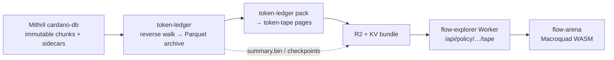

+++
title = "Scrubbing a Cardano token's whole life at a day per second"
date = 2026-10-28
draft = true
description = "How Mithril snapshots, compact day-chunked tapes, Cloudflare Workers + R2, and a Macroquad frontend make scrubbing NikePig's history feel instant — a tech demonstrator, not a TapTools replacement."
authors = ["Damon Oehlman"]
[taxonomies]
tags = ["rust", "cardano", "mithril", "cloudflare-workers", "macroquad", "token-tape", "architecture"]
[extra]
drafted_by = "Promoter Bot"
authorship_note = "from in-progress code and design notes across mitos, cnft.dev-workers, and shared-crates. Numbers marked measured come from those trees; [TODO] items still need Damon review before this ships."
+++

I still stand by the statement that I won't build a TapTools replacement. That does not stop me showing how damn fast things can be with Rust if you architect them well.

Open the TOKEN ARENA demo for $NikePig — or load it inline below — set the speed to **1D/S**, hit **ALL**, and watch the token's whole life scrub from its mint to now.



Prefer a separate tab: [flows.hodlcroft.com/arena (NikePig)](https://flows.hodlcroft.com/arena/?policy=c881c20e49dbaca3ff6cef365969354150983230c39520b917f5cf7c). Holders swim, pools open, the price line steps. That is the same history the archive holds — just not served as "give me a megabyte of JSON and hope the browser keeps up."

This is a tech demonstrator. A handful of tokens are supported. The point is the stack:

- Cardano **Mithril** snapshots, addressed over HTTP ranges
- Sensibly sized **chunks** with an incremental-update story
- **Cloudflare Workers + R2** on the read path
- **Macroquad** on the frontend
- And a solid debt of gratitude to [TxPipe](https://txpipe.io)'s **pallas** for the Cardano decoding layer

---

## Why it feels fast

Most token UIs are slow for a boring reason: they ask the wrong question of the wrong shape of data. A dense token's history is hundreds of thousands of movements. Fold that into JSON per request and you are paying for stringification, gzip, parse, and a party table the size of a small novel — every time someone opens a chart.

The arena does the opposite. History is **pre-folded** into compact binary files a browser can range-read. The Worker folds only a *page* of story into a tape the Macroquad client already knows how to play. Scrubbing is local. The network only has to keep the next page warm.

Three repos carry the work in progress:

| Repo | Branch | Role |
|---|---|---|
| `defrag-au/mitos` | `token-summaries` | Mithril ingest, policy archives, `token-tape`, `pack` |
| `defrag-au/cnft.dev-workers` | `token-summaries` | Workers, R2 reads, TOKEN ARENA |
| `defrag-au/shared-crates` | `damon-bonding-fun` | Macroquad trading widgets (`PriceChart`, treemap, …) |

---

## Mithril is a log. Treat it like one.

A Mithril cardano-db snapshot is `cardano-node`'s immutable directory: bare concatenated block CBOR in `NNNNN.chunk`, with `NNNNN.primary` / `NNNNN.secondary` as the node's own slot→byte-offset index. Mithril ships all three. That is what makes a snapshot usable *remotely* — not as a tarball you unpack once to bootstrap a node, but as something you can range-read for years.

`crates/mithril-source` (`mitos`, `token-summaries`) is deliberately dumb about Cardano semantics. It addresses bytes. From its crate docs:

> Nothing here decodes a block. It addresses bytes; the consumer decides what they mean — which is what lets the same reader serve `tx-index`, a book builder, and a Worker without any of them being special-cased.

Sequential walks cost **one HTTP range per 4 MiB window**, not per block. Random lookups take exactly the span. Spans are MiB-aligned because Cloudflare's origin range fetches pull whole 1 MiB cache lines from R2 anyway (`crates/mithril-source/src/chunk.rs`).

`token-ledger` walks those chunks for **one policy at a time**. Production uses the **reverse** walk (tip → mint into Parquet): newest rows first, so a token nobody has indexed is viewable in seconds. `pallas-traverse` / `pallas-addresses` / `pallas-primitives` sit on the buffer and mint-assembly path (`tools/token-ledger/Cargo.toml`). Shoutout again to TxPipe — without pallas this stack is a much sadder place.

What lands in the sealed archive: movements (mints, burns, transfers, fills), observations (pool / curve state), and enough structure for a later fold to recover price, holders, and a typed story stream. Completeness is measured against the policy's first mint — get the floor wrong and you quietly get a short archive that calls itself complete (`tools/token-ledger/README.md`).

---

## The tape: day chunks, then pages a replay can actually fetch

JSON tapes were the wrong shape. Measured on $NikePig (comments in `crates/token-tape/src/lib.rs`): one page was 13 hours, 4,393 events and 4,200 holders, **1.26 MB of JSON** (295 KB compressed), **1.5 s** to build, and about half a second of replay at a day a second. Half the bytes were holders; three quarters of those never appeared in the page's events — they were there to settle opening balances.

`token-tape` flips that:

- **Parties** numbered in chain order of first appearance from the token's first mint. Deterministic. Later builds only append. Fixed-width records so a range request fetches exactly one party.
- **Three streams** — `market`, `transfers`, `orders` — so a client fetches only what it shows.
- **One UTC day per stream** as a `TTCH` chunk. A past day never changes.
- **Pages** (`crates/token-tape/src/pages.rs`): a run of whole days cut when the grid hits `PAGE_BUDGET` (**3,000** events), carrying every chunk of those days *and* the identity / role / closing balance of everyone the page needs. One request opens a page. It settles on its own. Digested into the filename so republish only uploads what changed and every sealed page can be cached forever.

`token-ledger pack` is what writes this from a completed archive (`tools/token-ledger/src/pack.rs`). Party numbering is checked against anything already published: a quiet renumber would break every cached page, so a mismatch is an error.

### Incremental updates (the boring part that makes it cheap)

Full rebuilds do not belong on a 30-second timer. Measured on a development Mac for $NikePig (**722,667** movements, **98,468** parties): fold + handle names + write ~2,400 chunk files ≈ **8.7 s** (`docs/design/TOKEN_TAPE_INCREMENTAL.md`). Linear in movements. Re-deriving history that did not change is how you melt a box.

The rule, same as the rest of the artifact-sharding design:

> A sealed file is named by what it was derived from. Re-deriving it yields the same bytes. Growth adds files; it never edits one.

Sealed day chunks and full party segments are immutable. Everything not yet sealed is **one file, replaced whole** on refresh (`tail.bin` in the design). The box already runs two cadences for series/balances; the tape follows them: seal when a walk completes (~daily), tail on the tip refresh (~30 s). Readers never merge two versions of the same thing.

[TODO: Damon — confirm how much of TOKEN_TAPE_INCREMENTAL is landed on `token-summaries` vs still design; the doc header still says "design, nothing built" as of 2026-10-27 while `pack` / pages clearly exist.]

Publishing cost from the same note, for orientation: ~six object writes per token per seal and one per tail refresh; at 30 s for 33 tokens that is on the order of **~$0.40/day** on R2 before throttling. Treat as a planning figure, not a production invoice.

---

## Workers + R2: the box drops out of the read path

Once a walk is **complete**, the Worker reads the archive from R2 — byte ranges on Parquet footers and row groups — and never needs the walk box for that policy (`projects/flow-explorer/src/archive_r2.rs`). A per-policy **KV bundle** (manifest + every footer) collapses the "four round trips from Brisbane to ENAM" tax into one colo-cached read; then a page is one range request for its row group.

TOKEN ARENA's tape route (`projects/flow-explorer/src/tape.rs`) is the glue the Macroquad client cannot do itself — `policy-archive` pulls in parquet/chrono/wasm-bindgen and will not link under macroquad. So the Worker folds the story window, holders, and a short-wait live state into a plain serde `Tape`:

- **Newest** page: 2,000 movements, settled against holders
- **Older** page (`?to=`): 5,000 movements, for rewind
- **Delta** (`?from=`): only what is new — the poll path, so you are not re-downloading 400 KB to add three beats

Cache headers match the mutability: older pages `max-age=3600`, newest/deltas `max-age=60`, overview `max-age=300`. Failures answer **200** with an `unavailable` body because the client's HTTP stack drops other statuses silently. That is the kind of wart you only discover by shipping a game into a phone browser.

The whole-life strip under the chart comes from `summary.bin` folded on the box when a walk completes — daily candles, holder counts, checkpoints every ~25k movements. Folding NikePig's observations inside the Worker died with a 1101 after ~26 s; the summary exists so that never has to be the overview path again.

---

## Macroquad on the front: a sea, not a spreadsheet

`flow-arena` is a Macroquad gamekit screen (`projects/flow-explorer/arena/`). The token is a sea. Pools are ships. Holders are creatures sized by share of circulating supply — shrimp through kraken. Burns, locks, stakes and venues sit on the seabed for what they are, not ranked as "holders." Trades are swaps you can see. Replay runs in chain time at `1M/S` … `1D/S`. Silence longer than two seconds at the chosen rate is cut and named (`3 DAYS LATER`).

The price chart itself lives in shared-crates as `ui/macroquad-widgets/src/price_chart.rs` (branch `damon-bonding-fun`): time on the x-axis (a quiet week as wide as a busy one), step line, buy/sell volume band, scrub that finds the last shown beat at or before the finger. The arena's overview strip and focus plot share that time axis on purpose — a moment sits at the same share of both.

Phone-first (390×844 design), wide from 1,000 units. Native builds are a review harness; the browser fetches `/api/policy/{id}/tape`. Share as `/arena/?policy=<id>&span=all&speed=1d`.

---

## On the AI co-development bit

The X post gave top marks to DeepSeek and Claude for playing a part in co-developing this demonstrator. Fair. Large stretches of the work-order trail on `token-summaries` are human-directed, model-assisted implementation with review gates. The architecture opinions — seal vs tail, pages vs day chunks, "the Worker folds, the client plays" — are still the boring human ones you get from measuring NikePig until the JSON hurts. Models accelerate the typing. They do not invent the 8.7-second rebuild number.

---

## Limitations, honesty, what's next

- **Only a handful of tokens** are wired through the registry and walked (`tools/token-ledger/tokens.toml`: aliens, dong, cswap, wrt, perp, nikepig, bunny, …). This is a demonstrator, not a catalogue.
- Multi-unit / NFT collection tapes are explicitly out of scope for the current format.
- Ambiguous events (several parties on one side — often airdrops) are in no stream. NikePig has a lot of them; neither the old tape nor this one shows them.
- Live edge (provisional trades as blocks land) is best-effort until a page settles the same slot.
- [TODO: Damon — confirm TOKEN_TAPE_INCREMENTAL landed vs design; Defrag blog URL once Cloudflare Pages is live; any production tape cold/warm figures to quote; which tokens to name as supported in the published version.]

Have a play: [NikePig in TOKEN ARENA at 1D/S from the start of time](https://flows.hodlcroft.com/arena/?policy=c881c20e49dbaca3ff6cef365969354150983230c39520b917f5cf7c).

If the chart feels suspiciously snappy, that is the architecture working. If it does not, open an issue — or better, a work order.
